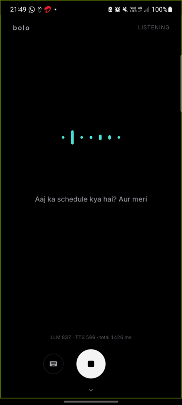
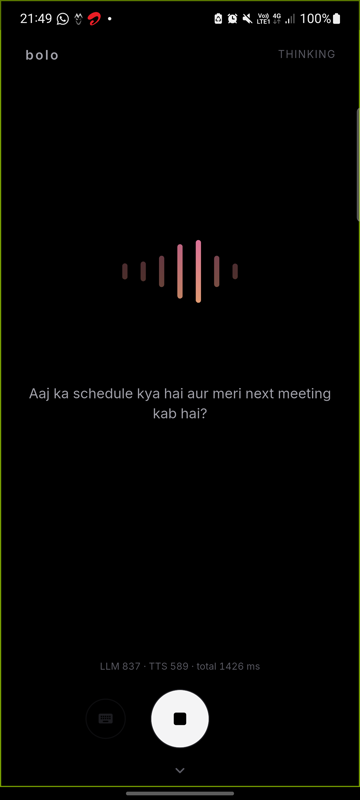
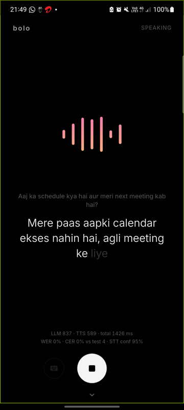
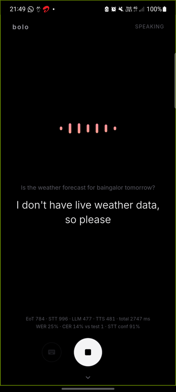
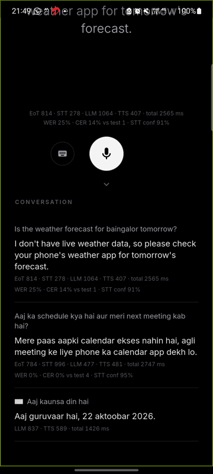

# Bolo


**A hands-free voice assistant for English and Hinglish, with speech recognition and speech synthesis
running entirely on the phone.**

You speak; Bolo transcribes on-device, gets a reply from a cloud LLM (Groq), and speaks it back in the
language you used: English in an English voice, Hinglish in a Hindi voice. Only the reply text crosses
the network.

Built for the IISc Computational Intelligence Lab internship assignment (Round 1), which scores end-to-end
latency, transcription accuracy and pronunciation, especially for Hinglish.

| Listening | Thinking | Hinglish reply | English reply | History |
|---|---|---|---|---|
|  |  |  |  |  |

## Contents

- [Features](#features)
- [Download](#download)
- [How it works](#how-it-works)
- [Tech stack](#tech-stack)
- [Performance](#performance)
- [Getting started](#getting-started)
- [Usage](#usage)
- [Project structure](#project-structure)
- [Design decisions](#design-decisions)
- [Limitations](#limitations)
- [License](#license)
- [Acknowledgements](#acknowledgements)

## Features

- **On-device speech recognition**: Whisper-Hindi2Hinglish-Swift via whisper.cpp. One model handles
  English, Hinglish and code-switched sentences, with no language detection or engine switching.
- **On-device speech synthesis**: Piper voices, Hindi (`hi_IN-priyamvada`) and English (`en_US-lessac`),
  picked per phrase by script.
- **Hands-free conversation**: tap once and talk. The turn ends after 0.7 s of silence, the reply is
  spoken, and the mic reopens. Eight seconds of silence ends the conversation; a tap stops it.
- **Streaming end to end**: live transcript while you speak, the LLM reply streamed token by token, and
  speech starting after the first 3 words while the rest is still being generated.
- **Live visuals**: frequency bars follow your voice (mint to aqua) and the assistant's (peach to coral);
  while it thinks, a sweep of light runs across them. The reply text appears word by word, in time with
  the audio.
- **Readable Hinglish**: replies are spoken from Devanagari but shown in Roman Hinglish
  ("Theek hai, aapki meeting 5 baje hai.").
- **Live metrics**: under every reply, a latency breakdown (end of turn, STT, LLM, TTS, total), plus WER
  and CER when what you said matches one of the four assignment test sentences, plus STT confidence.
  Scroll down for the conversation history with the same numbers per turn.
- **Typing fallback**, and clear messages for no internet, a rejected key, rate limits and stalled
  replies.

## Download

Get the APK from the [latest release](https://github.com/Sanjay-Sunil/Bolo/releases/latest).

- Android 8.0 or newer on a 64-bit (arm64) phone. The APK is about 49 MB.
- On first launch the app downloads 126 MB of models (speech recognition, voice activity, two voices)
  and checks each file's SHA-256. After that, speech works offline.
- Replies need a free Groq API key from [console.groq.com](https://console.groq.com). The app asks for
  it once and keeps it in the phone's encrypted storage. Long-press **bolo** at the top to change it.

## How it works

```
mic (16 kHz PCM)
  └─▶ VAD isolate ── Silero VAD v5 · segmenter (pauses, end of turn) · FFT bands for the bars
        └─▶ STT isolate ── Whisper-Hindi2Hinglish-Swift (whisper.cpp, q8_0)
              └─▶ main isolate ── Groq chat completion (streamed) ─▶ phrase splitter
                    └─▶ TTS isolate ── text normalizer · Piper (hi_IN / en_US) · FFT bands
                          └─▶ gapless PCM playback, reply text revealed in sync
```

Each model runs in its own Dart isolate (VAD, STT, TTS), so inference never blocks the UI. The main
isolate owns the mic, the speaker, the LLM stream and the screen.

1. **Listening.** Silero VAD marks speech in every 32 ms window. The segmenter turns that into speech
   start, short pauses (200 ms) and end of turn (700 ms).
2. **Transcribing.** About every 0.7 s the whole turn so far is re-transcribed for the live text. At each
   short pause an early final transcription starts. If no more speech follows, it is already the final
   transcript when the turn ends, which hides most of the STT time.
3. **Replying.** The transcript goes to Groq with a short system prompt and four example exchanges. The
   reply streams back and is cut into phrases: the first after 3 words or at a comma, later ones at
   punctuation.
4. **Speaking.** Each phrase is normalized (numbers, symbols, English words in Hindi text), synthesized
   by the voice that matches its script, and queued for gapless playback. Phrase n+1 is synthesized
   while phrase n plays.

Latency is measured from the **last voiced audio frame** to the first sample of reply audio, so the
end-of-turn silence is included.

## Tech stack

| Part | Choice |
|---|---|
| App | Flutter 3.47 (Dart), Riverpod |
| Voice activity | Silero VAD v5 via sherpa-onnx |
| Speech recognition | [Whisper-Hindi2Hinglish-Swift](https://huggingface.co/Oriserve/Whisper-Hindi2Hinglish-Swift), whisper.cpp v1.9.5, q8_0, via a small C wrapper and Dart FFI |
| LLM | Groq, `qwen/qwen3.8-27b`, OpenAI-compatible streaming API |
| Speech synthesis | Piper `hi_IN-priyamvada-medium` and `en_US-lessac-medium` (int8) via sherpa-onnx |
| Audio | `record` (mic, 16 kHz), `flutter_pcm_sound` (playback, 22.05 kHz) |
| Storage | `flutter_secure_storage` for the API key |

## Performance

Measured on a Samsung Galaxy M52 5G (Snapdragon 778G, 6 GB RAM, Android 13), release build, 4 inference
threads.

### End-to-end latency

Automated run: a laptop speaks the four assignment sentences out loud in three different voices (12
turns) and the phone listens hands-free.

| Stage | Median | Worst |
|---|---|---|
| End of turn (0.7 s silence) | 801 ms | 824 ms |
| Speech recognition, after end of turn | 399 ms | 681 ms |
| LLM first token | 426 ms | 536 ms |
| First token to first audio | 477 ms | 524 ms |
| **Last spoken word to first reply audio** | **2.10 s** | **2.28 s** |

Groq's response time varies between runs by about ±0.2 s on the median. Typed messages skip the silence
wait and STT and take 1.2 to 1.4 s to first audio.

### Transcription accuracy

| Setting | WER | CER |
|---|---|---|
| A person speaking the four sentences into the phone | 15% | |
| Synthetic voices played from a laptop speaker (12 turns, several runs) | 37.5% to 44.2% | 26% to 32% |

Numbers are normalized before scoring ("saat" = 7, "5PM" = "5 pm"), as in Whisper's own evaluation.
Laptop-speaker audio picked up across a desk is much harder than speech into the phone.

### Model choices

Speech recognition (decode time for a 2 to 4 s clip):

| Runtime | Decode | RAM |
|---|---|---|
| whisper.cpp q5_1, 30 s window | ~2.8 s | +99 MB |
| whisper.cpp q8_0, 30 s window | ~2.0 s | +118 MB |
| **whisper.cpp q8_0, 10 s window** | **0.58 to 0.72 s** | +118 MB |

Speech synthesis:

| Voice | First phrase | Real-time factor | RAM | Round-trip WER |
|---|---|---|---|---|
| Kokoro-82M int8, Hindi | 1.9 s | 1.55 | +277 MB | 15.4% |
| Kokoro-82M fp32, Hindi | 1.3 s | 1.03 | +454 MB | 15.4% |
| **Piper hi_IN-priyamvada int8** | **0.2 s** | **0.29** | +19 MB | 17.9% |
| **Piper en_US-lessac int8** | | 0.28 | +40 MB | 10.0% |

Round-trip WER: synthesize a sentence, transcribe it with Swift, compare. It measures intelligibility.

LLM (21 English and Hinglish questions, including noisy transcripts):

| Model | Right language and script | First token, median / p90 |
|---|---|---|
| **qwen/qwen3.8-27b** | **20/20** answered | **334 / 588 ms** |
| openai/gpt-oss-120b | 19/21, once leaked its reasoning into the reply | 639 / 950 ms |
| openai/gpt-oss-20b | 16/20 | 903 / 2002 ms |

Full measurements and experiments: [`tools/bench/results.md`](tools/bench/results.md).

## Getting started

### Prerequisites

- Flutter 3.47 or newer
- Android SDK with NDK and CMake 3.22 (installed by Android Studio's SDK manager)
- An arm64 Android phone with USB debugging, Android 8.0+
- A Groq API key (free)

### Build and run

```bash
git clone --recursive https://github.com/Sanjay-Sunil/Bolo.git
cd Bolo
cp .env.example .env    # optional: put your key in GROQ_API_KEY to skip the in-app prompt
flutter pub get
flutter run --release --dart-define-from-file=.env
```

`--recursive` fetches whisper.cpp, which is built from source by the Android Gradle build. Without a key
in `.env`, the app asks for one on first use. `.env` is git-ignored.

### Tests

```bash
flutter analyze
flutter test    # 155 unit tests
```

The tests cover the segmenter, transcriber scheduling, SSE parsing, the LLM client, phrase splitting,
text normalization, loanwords, Roman Hinglish, WER/CER and the frequency bands.

### Rebuilding the speech model

`tools/convert_swift_ggml.sh` converts the Hugging Face checkpoint to whisper.cpp ggml (f16, q5_1,
q8_0). The app downloads the published q8_0 file from the
[`models-v1`](https://github.com/Sanjay-Sunil/Bolo/releases/tag/models-v1) release.

## Usage

1. Tap the mic (or the bars) and speak in English or Hinglish.
2. Pause. After 0.7 s the reply is spoken, with its text appearing in the centre.
3. Keep talking after each reply; the mic reopens on its own. Tap to stop.
4. Tap the keyboard to type instead.
5. Scroll down for the history, with latency, WER/CER and STT confidence per turn.

Try the assignment sentences:

- What is the weather forecast for Bangalore tomorrow?
- Can you set a reminder for my meeting at 5 PM?
- Mujhe kal subah 7 baje ka alarm set karna hai.
- Aaj ka schedule kya hai, aur meri next meeting kab hai?

## Project structure

```
lib/
  app/           model download (ModelManager), clock, thread budget
  audio/         gapless PCM player, FFT band levels for the visualizer
  conversation/  hands-free state machine (ConversationController) and its view models
  llm/           streaming Groq client, SSE parser, system prompt and examples, API key store
  pipeline/      latency metrics, WER/CER, the four test sentences
  stt/           whisper.cpp FFI engine, STT isolate, whole-turn transcriber
  text/          Devanagari to Roman Hinglish for display
  tts/           Piper engine, TTS isolate, phrase splitter, text normalizer, loanwords, numbers
  ui/            main screen, frequency bars, reply text, key sheet, palette
  vad/           Silero detector, segmenter, VAD isolate
  spike/         on-phone test screens used to choose the runtimes and voices
native/          C wrapper around whisper.cpp (prompt, token probabilities, audio window)
third_party/     whisper.cpp v1.9.5 (git submodule)
tools/           model conversion script, benchmark results
docs/            screenshots
```

## Design decisions

- **One code-switching STT model.** A language-detection step routing to separate Hindi and English
  engines garbles mixed sentences. Swift writes Hinglish in Roman script and English as English.
- **A 10 s minimum encoder window.** Whisper normally pads to 30 s. Shrinking the window to 10 s makes
  decoding about 3x faster. Going below about 500 frames breaks Hinglish: "Aaj ka schedule kya hai?"
  became "Hello.".
- **Whole-turn transcription.** With a 10 s window, decoding the whole turn costs the same as decoding a
  short piece, and it is more accurate than stitching pieces together.
- **Piper over Kokoro.** Kokoro sounds good but runs slower than real time on this phone. Piper is about
  4x faster with the same intelligibility.
- **Hinglish replies in Devanagari.** The Hindi voice only knows Hindi phonemes, so the LLM writes
  Hinglish entirely in Devanagari. About 160 common English words left in Latin script ("meeting",
  "schedule") are respelled before synthesis. This cut round-trip WER on such replies from 23.5% to
  14.7%.
- **Numbers written by code.** The LLM writes digits, and the text normalizer turns them into Hindi or
  English words. Models often get Hindi number words wrong.
- **No Whisper prompt.** Context prompts and word lists did not lower WER on recorded turns.
- **Mic closed while speaking.** This avoids the assistant hearing itself without needing echo
  cancellation tuning.

## Limitations

- Groq's response time is the least predictable stage, and its free tier rate-limits bursts of requests.
- STT mishears some names and phrases ("Bangalore" as "bangaar"), especially from a distance.
- No barge-in: tap to stop the assistant while it speaks.
- No device actions (alarms, reminders, calendar) by design. The assistant says so and suggests what to
  do.
- Android arm64 only.

## License

[MIT](LICENSE) for this project's code. The models and libraries it uses keep their own licenses (see
below).

## Acknowledgements

- [Whisper-Hindi2Hinglish-Swift](https://huggingface.co/Oriserve/Whisper-Hindi2Hinglish-Swift) by
  Oriserve (Apache-2.0), converted to ggml for this app
- [whisper.cpp](https://github.com/ggml-org/whisper.cpp) (MIT)
- [sherpa-onnx](https://github.com/k2-fsa/sherpa-onnx) (Apache-2.0), for Silero VAD and Piper inference
- [Silero VAD](https://github.com/snakers4/silero-vad) (MIT)
- [Piper](https://github.com/rhasspy/piper) voices `hi_IN-priyamvada-medium` and `en_US-lessac-medium`;
  see each voice's model card for its dataset license
- [Groq](https://groq.com) for the LLM API
- [Inter](https://rsms.me/inter/) typeface (SIL Open Font License, `assets/fonts/OFL-Inter.txt`)
